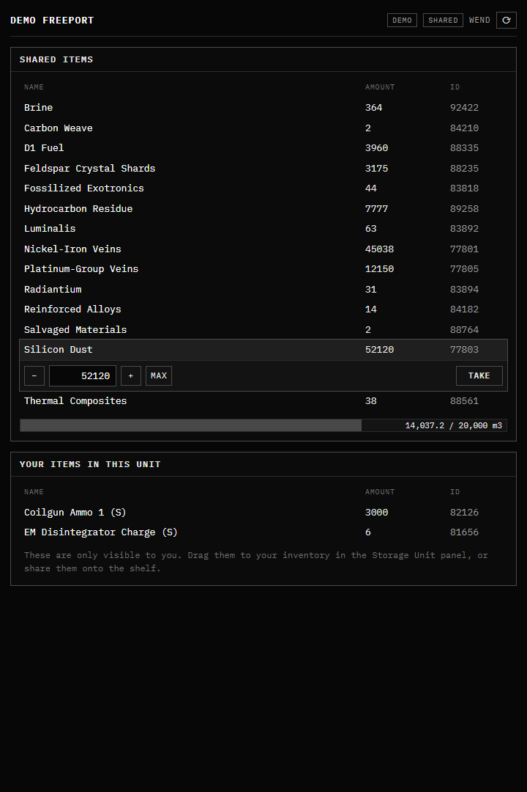
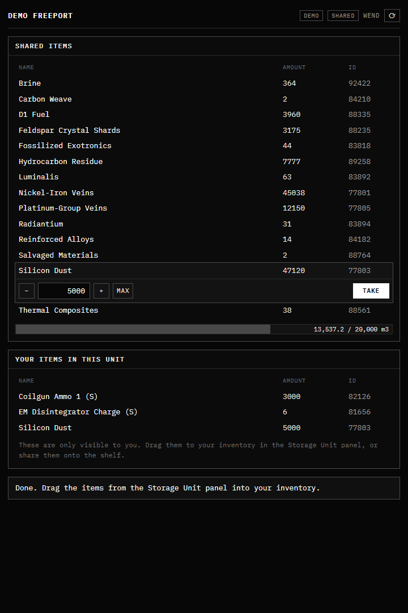

# SSU Open Shared Withdraw

A minimal EVE Frontier Smart Storage Unit dApp for a **shared open shelf**,
built to look and feel like the game's own storage interface. The design
principle: *the storage unit's main hangar IS the shared shelf.*

- **Owner**: drags items in and out of the unit in game, exactly as normal.
  Zero dApp interaction to stock or reclaim. One-time "Enable shared access"
  click authorizes the extension.
- **Anyone else**: sees the unit as two storage windows drawn like the
  game's own inventory (item icons, count badges, capacity bars): shared
  storage on top, their own items in this unit below. Drag a stack down to
  take it (hold Shift to pick an amount, typed and confirmed with Enter, or
  double-click for the whole stack). Ctrl-click, Shift-click or drag a box
  over empty space to select several stacks, then drag any one of them to
  move the lot (always whole stacks, Shift is ignored); Ctrl+A selects a
  whole window and Escape clears. Staged moves show as ghost tiles until
  **Take all** sends them all in one transaction. The items land in their own slot ("STORAGE UNIT" panel
  in game) → drag them into their inventory.
- **Depositing**: drag items into the STORAGE UNIT panel in game (they go to
  your own slot), then press **Share all** in the dApp, or drag individual
  stacks up, to move them into shared storage. One transaction either way.

Live deployment: <https://ssu-open-shared-withdraw.pages.dev>
(`?demo=1` renders canned data with simulated transactions — no wallet or
chain access needed; useful for previews and screenshots.)

## How it works on chain

`move/ssu_open_claim` publishes a `ClaimAuth` extension witness. Once the
owner authorizes it (`storage_unit::authorize_extension`), the module exposes:

| Function | Who signs | What it does |
|---|---|---|
| `take(su, character, type_id, qty)` | any character | main hangar → caller's owned slot (`withdraw_item<ClaimAuth>` + `deposit_to_owned<ClaimAuth>`; sender must own the character) |
| `put(su, character, cap, type_id, qty)` | any character | caller's owned slot → main hangar (`withdraw_by_owner<Character>` + `deposit_item<ClaimAuth>`) |
| `authorize(su, owner_cap)` | unit owner | enables shared access (single extension slot: replaces any other dApp's witness) |
| `claim_from_open` / `stock_open` / `share_to_open` | — | v2 legacy (open-inventory shelf); kept for upgrade compatibility, and the app still drains open-inventory leftovers on take |

Key world-contract facts this relies on (v0.0.24, `testnet_stillness`):

- An authorized extension may deposit/withdraw the **main** inventory with
  just the witness — no OwnerCap. That is what lets the main hangar be the
  shelf.
- `deposit_to_owned` lazily creates the per-character slot; the game shows
  that slot to its owner in the STORAGE UNIT panel and lets them drag items
  out (burn to game).
- A StorageUnit has **one** extension slot (`swap_or_fill`): authorizing this
  dApp replaces e.g. Trinary Exchange on that unit, and vice versa. The app
  warns the owner before replacing a foreign extension. Never call
  `freeze_extension_config` — it is one-way.
- Volumes/capacities on chain are m³ × 100; each bucket carries its own
  `used_capacity` / `max_capacity`, which the app renders as the game-style
  capacity bar.

## Current testnet deployment

- Environment: `testnet_stillness` **Cycle 7**, world package
  `0x7be18d6294e533bedd9a5d70a96ce8d9d4b87a7c74188ba65d3fe966bbed9d92`
  (upstream `evefrontier/world-contracts` main `d33ff232b`, pinned by git in
  `move/ssu_open_claim/Move.toml`)
- Claim package (fresh v1 publish, 2026-10-01, tx
  `7dKQbwN18kQj3apx87nghuo9sg6rRX694UbDEVg8DLbz`; published-at and original
  id are the same, so it is also the ClaimAuth witness's defining id):
  `0x679214b103db42dd074bb454914e61b18ac881b9a9e9f121a9b318dd61c56594`
- UpgradeCap: `0x5b9ce05bb839f145c4f62d4ded08facf0a49944f0934dfc1351248489fb1c4c8`
  (held by the operator CLI address)

Upgrades within a cycle: `sui client upgrade move/ssu_open_claim` (CLI ≥ the
network's protocol version; `suiup install sui@testnet` to refresh), then copy
the new `published-at` from `move/ssu_open_claim/Published.toml` into
`VITE_CLAIM_PACKAGE_ID` and redeploy the app. Authorized units keep working
without re-authorization (witness identity is anchored to the original id).

New cycle (CCP publishes a new world package): an upgrade cannot relink to a
new world, so bump the world `rev` in `Move.toml` to the upstream commit whose
`contracts/world/Published.toml` carries the new `testnet_stillness` world,
delete this package's `[published.testnet_stillness]` block, and do a fresh
`sui client publish`. Both claim ids then change; update `app/.env.production`,
the fallbacks in `app/src/config.ts` and `app/src/unitState.ts`, and any
embedding host's copy of the ids. Units authorized in the old cycle stay
orphaned on the old world; owners enable sharing again.

Earlier deployments: Cycle 6 world `0x8b8a46ed…1aa1`, claim v3
`0x37bf31ff…46e3` (original `0x4defff87…f610`).

## App

Vite + React + `@evefrontier/dapp-kit` in `app/`. Reads go through the public
Sui GraphQL endpoint (paginated dynamic-field walk in `src/unitState.ts`);
item names come from `app/src/data/typeNames.json` (a typeId -> name map
extracted from the game client's type table, regenerated on patch day), with
the world API (`/v2/types/{id}`) as a fallback for ids the map lacks. The
world API stopped listing new content in mid-2026, so the bundled map is what
keeps newer items from rendering as "type 95988".

### Item icons

The tiles use the game client's own 64 px inventory icons. They are CCP's art,
so they are **not committed**: `app/public/icons.json` and
`app/public/icons/` are gitignored and generated from a local EVE Frontier
client before any build that gets deployed. Without them the app still works
and draws blank tiles; `vite build` warns and `scripts/sync-to-efmap.mjs`
refuses to run (set `ALLOW_NO_ICONS=1` to override).

Format, for anyone producing them from their own client:

- `icons/<hash>.png`: one file per distinct icon, named by the first 12 hex
  characters of the file's MD5 (content-addressed, safe to cache forever).
- `icons.json`: `{ "schema": 1, "clientBuild": <build>, "icons": { "<typeId>": "<hash>" } }`.

Resolution follows the client: `type.iconID` → `iconIDs[iconID].iconFile`;
types without one (ships, deployables) use their pre-rendered hull icon,
`graphicIDs[graphicID].iconInfo.folder` + `/<graphicID>_64.png`.

### Moving items

Every staged move, takes and shares together, goes out as ONE programmable
transaction (`buildMoveTx` in `app/src/transactions.ts`): one signature, one
gas charge. Shares borrow the character's OwnerCap once and pass it to every
`put`. Drag and drop uses plain pointer events rather than the HTML5
drag-and-drop API, which off-screen browser hosts like the in-game one do not
reliably support.

### Item keys

A storage inventory is keyed by a u64. An item with a variant packs it into
the key the way the game client does: `key = (variant << 32) | type_id`, so
`type_id = key & 0xFFFFFFFF` and `variant = key >> 32` (0 = none). Items
without a variant keep their plain type id. Packed keys run past 2^53, where
`Number()` rounds to a different item, so keys stay exact decimal strings
from the inventory read to the transaction argument (`src/chainKey.ts`).
Names and icons resolve by the base type, so variants of one type cost one
lookup; each variant is still its own tile, with a "Variant N" badge under
its name (the game's own label for a variant stack) and in its tooltip. Since
the 2026-11-10 patch many Stillness stacks carry a variant, old items such as
Reinforced Alloys included. Chain quantities are whole units: an amount below
1 is refused with a message before it reaches the contract, which aborts on 0.

### Wallet messages

`src/txOutcome.ts` turns every wallet outcome into one short sentence. The
game client's wallet throws `Error(JSON.stringify(error))`: code 4001 is the
player rejecting in the game's approval window, and code -32009 is an
on-chain failure carrying the failed transaction, whose Move abort is read
for a reason when it can be. Other wallets' decline sentences ("rejected by
user") get a plain decline message, a `FailedTransaction` result reads as an
on-chain failure, a result the app cannot confirm (no digest, a timeout, or
one it cannot decode) clears the staging and re-reads the unit, and anything
else gets a readable fallback, never raw JSON. Nothing times out while the
player decides.

```powershell
pnpm install
pnpm --dir app test           # vitest: item keys, transactions, wallet messages
pnpm --dir app build          # tsc + vite build
sui move test --path move/ssu_open_claim
npx wrangler pages deploy dist --project-name ssu-open-shared-withdraw --branch main  # from app/
```

URL parameters (all optional, first match wins for the unit):

- `storageUnitId` / `objectId` / `assemblyId` / `ssu` — Sui object id of the
  unit (bake this into the URL you set on the unit).
- `itemId` + `tenant` — appended automatically by the in-game browser; the
  dapp-kit resolves them to the object id.
- `characterId` — manual override for local testing.
- `demo=1` — canned data, simulated transactions.

Set the unit's dApp URL (in game: Edit Assembly → dApp URL, or on chain via
`storage_unit::update_metadata_url`, owner-signed) to:

```
https://ssu-open-shared-withdraw.pages.dev/?storageUnitId=<unit object id>
```

The `?storageUnitId=` part is REQUIRED — the game does not pass the unit to
custom dApp URLs on its own.

## Owner setup

1. Open the dApp on the unit (in game, or in a browser with EVE Vault and
   `?storageUnitId=`).
2. Connect the owner wallet → the banner offers **Enable shared access**
   (one transaction; the unit's OwnerCap id is read from the unit object).
3. Drag stock into the unit in game. Done — visitors can take, and anything
   they share lands in the main hangar where you see it natively.

## Screenshots

These show the earlier list view; the icon grid replaced it.

| | |
|---|---|
|  |  |

`docs/screenshots/shot-prod-real.png` shows the deployed app reading a live
third-party unit (read-only, foreign extension notice).

## Verified in game (2026-07-11 smoke tests)

- The dApp loads in the BEHAVIOR panel; the in-game wallet connects and
  auto-reconnects, and signs custom extension transactions (authorize
  succeeded; the wallet pays gas — sponsorship doesn't cover custom calls).
- **The game does NOT append `?itemId=` to custom dApp URLs** (despite the
  builder docs): the URL set on the unit MUST carry the unit id itself,
  `?storageUnitId=0x…`. The in-app `itemId` derivation is kept in case CCP
  changes this.
- Transaction results: the dapp-kit resolves with
  `{ $kind: "Transaction", Transaction: { digest, … } }`, so the digest sits
  inside `Transaction`. The first note here, that the in-game wallet reports
  success "without a digest", came from reading the top level; the client's
  signer does return one. A result without a digest now counts as
  unconfirmed: the app says so and re-reads the unit (src/txOutcome.ts).
- The wallet may carry PlayerProfiles from retired cycles; the character
  lookup filters by the current world package (src/usePlayerCharacter.ts).
- The dapp-kit's own resolver needs `VITE_EVE_WORLD_PACKAGE_ID` set — it
  throws without it.
- The 8s poll picks up in-game drags in and out without manual refresh.
- Owner detection: the unit's OwnerCap is owned by the character OBJECT
  (AddressOwner whose address is the character id on the GraphQL schema).
- Owners can disable shared access again (Owner setup → Disable; calls
  `storage_unit::revoke_extension_authorization`).

## Still to verify in game

- A successful take on the current client still ends in "Done" (it now
  requires the digest the dapp-kit reports inside `Transaction`).
- The game's approval window: one take and one share go through, and one
  Reject shows "You declined the request in the game's approval window."
- A take of a variant stack in game with this build. (Checked 2026-11-10
  against a live unit: every variant stack reads with its base name, icon and
  badge, and a built take carries the exact key.)
- Dragging tiles between the two storage windows inside the in-game browser
  (pointer-event drag, verified in desktop Chrome; double-click is the
  fallback if a host swallows drags).
- Ctrl-click and box selection in the in-game browser (verified in desktop
  Chrome). The amount box confirms on Enter's key-down rather than by form
  submission, because the in-game browser was seen not to submit on Enter.
- The full visitor flow (take + share) with a second character, and how
  promptly the game's STORAGE UNIT panel reflects a take.
